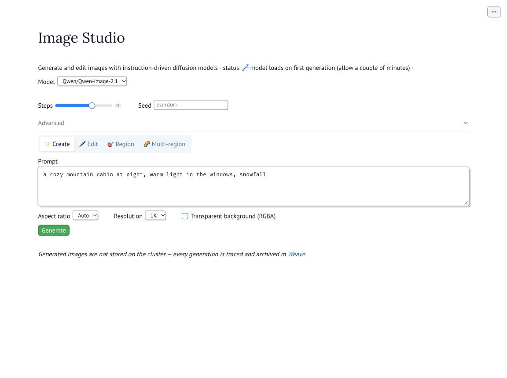
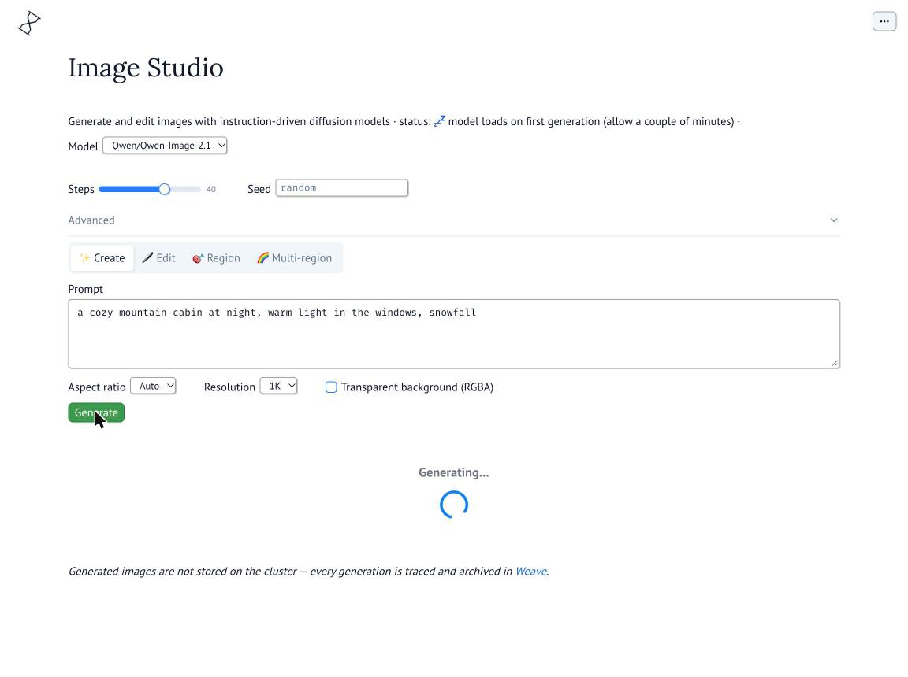
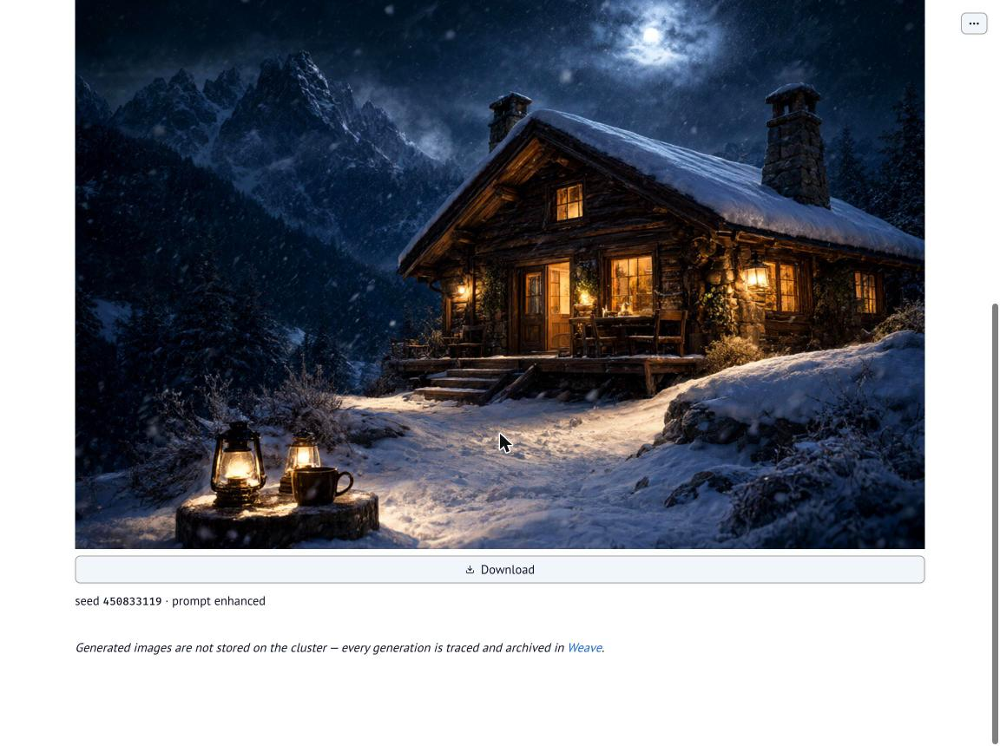
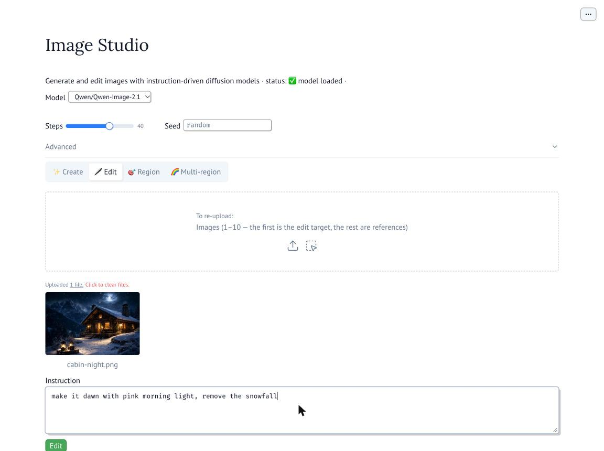
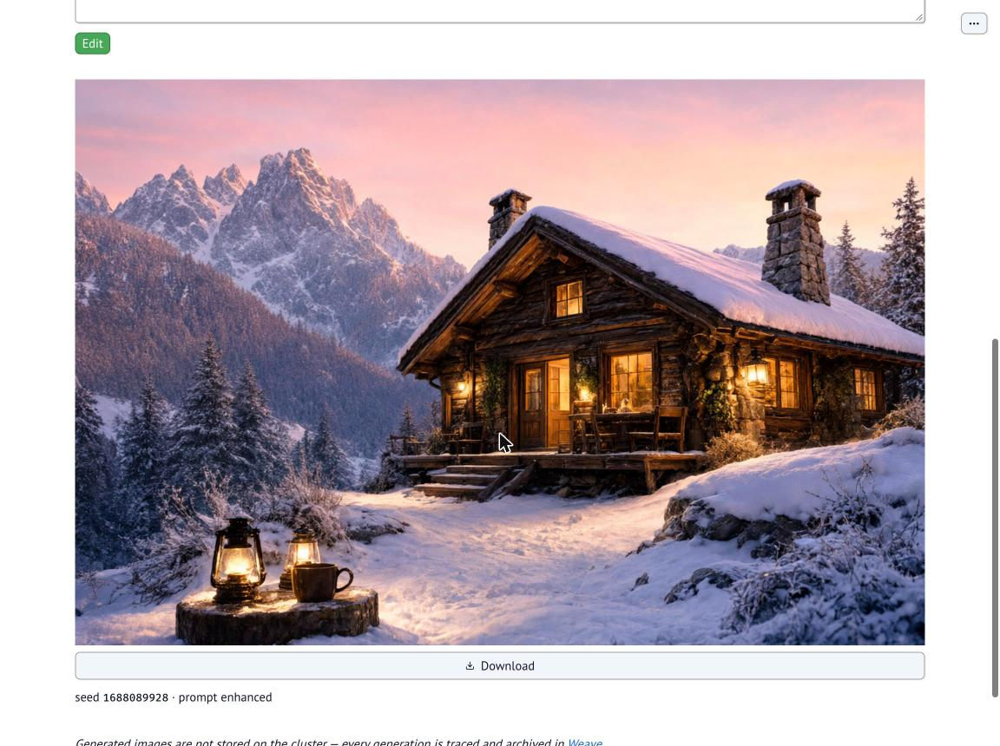
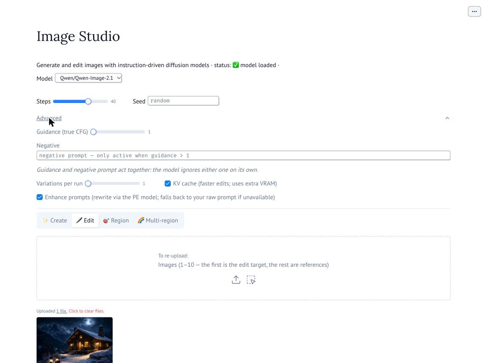

# Image Studio

A [marimo](https://marimo.io) web app for working with instruction-driven image
models — text-to-image, instruction editing, multi-reference composition, and
draw-on-image region editing — running on a CoreWeave Slurm cluster (2× H100)
and used from your Mac through an SSH tunnel. The hosted model is
**Qwen-Image-2.1**, fronted by the official Qwen prompt-enhancement models and
orchestrated as agents (OpenAI Agents SDK), with every generation traced to
[Weave](https://wandb.ai/wandb-smle/jb_image_editing_tool/weave).

| Doc | What |
|---|---|
| [`docs/architecture.md`](docs/architecture.md) | Components, request lifecycle, compute table, scripts, failure modes, gotchas |
| [`docs/model.md`](docs/model.md) | Qwen-Image-2.1 capabilities, resolutions, prompting tips, PE models |

## How it works

A quick tour of the running app at <http://localhost:2718>, captured live.

### 1. Describe what you want



Type a prompt on the **✨ Create** tab; Steps and Seed sit above the tabs and
apply to every mode. You never submit this text verbatim — a PromptEnhancer
agent (a vLLM-served Qwen PE model) rewrites it before generation, and with
Aspect ratio on **Auto** the enhancer also picks the ratio that suits the scene.

### 2. Generate



All four tabs share one results area below the tabs: pressing any run button
clears the previous image instantly and shows the spinner, so what you see is
always the latest run.

### 3. The result



The finished image arrives with a **Download** button (served straight from
memory — nothing is written to cluster disk) and a caption recording the seed
and that the prompt was enhanced. Auto aspect chose 3:2 (1248×832) for this
prompt. The whole run also lands in
[Weave](https://wandb.ai/wandb-smle/jb_image_editing_tool/weave) as a trace
plus a row in the `image-generation-log` dataset.

### 4. Edit: upload and instruct



The **🖊 Edit** tab takes 1–10 images (the first is the edit target, the rest
are references) and shows a thumbnail preview per upload. The edit itself is a
plain-language instruction — here, re-lighting the generated cabin.

### 5. The edited result



Same cabin, now at dawn with the snowfall gone. Edits inherit the input
image's size and get the same seed caption, download button, and Weave trace.

### Advanced controls



The **Advanced** accordion exposes true-CFG guidance with a negative prompt,
multiple variations per run, a KV-cache toggle for faster edits, and the
switch for prompt enhancement itself (off = your raw prompt goes straight to
the pipeline).

## Setup (first time)

One-time, from a fresh Mac; day-to-day use is just [Running it](#running-it).
This local repo is the **source of truth**; the cluster copy executes.

1. **Clone the repo and install [uv](https://docs.astral.sh/uv/) locally:**

   ```bash
   git clone <repo-url> qwen2.1_image && cd qwen2.1_image
   curl -LsSf https://astral.sh/uv/install.sh | sh
   ```

2. **SSH config.** The scripts reach the cluster exclusively through the host
   alias `coreweave-login` (override with `SSH_HOST=<alias>`). Add to
   `~/.ssh/config`:

   ```
   Host coreweave-login
       HostName <cluster-login-node>
       User <your-cluster-username>
   ```

   ```bash
   ssh coreweave-login true   # must succeed (silently)
   ```

3. **W&B key + Weave project.** Create `.env` in the repo root (gitignored):

   ```bash
   echo 'WANDB_API_KEY=<your Forge/W&B key>' > .env
   echo 'WEAVE_PROJECT=wandb-smle/jb_image_editing_tool' >> .env
   ```

   `scripts/sync.sh` copies the key — outside the rsync tree — into a
   chmod-600 file on the cluster (`/mnt/data/jbutt+cwb607/.wandb_key`);
   `scripts/launch.sh` reads `WEAVE_PROJECT` from `.env` and exports it into
   the remote marimo process, so changing it in `.env` and relaunching
   switches tracing projects. Both are optional: without either the app runs
   identically but untraced.

4. **Cluster prerequisites.** These already exist for the current deployment
   under `/mnt/data/jbutt+cwb607/` — a new developer only needs to verify:

   ```bash
   ssh coreweave-login ls /mnt/data/jbutt+cwb607
   # expect: bin/ (uv) · qwen2.1/ (project + .venv) · vllm-env/ · hf/
   ```

   If any are missing, recreate them:

   - **`bin/uv`** — the uv binary the scripts use for remote dependency syncs.
   - **`qwen2.1/` + app venv** — project copy with a **uv-managed Python 3.10**
     venv; created by the remote `uv sync` that `scripts/sync.sh` performs
     (force it with `scripts/sync.sh --deps`).
   - **`vllm-env/`** — separate venv for the PE servers (Python 3.12):

     ```bash
     ssh coreweave-login
     cd /mnt/data/jbutt+cwb607
     bin/uv venv --python 3.12 vllm-env
     bin/uv pip install --python vllm-env/bin/python vllm ninja
     ```

   - **`hf/`** — model weights pre-downloaded into `HF_HOME`, e.g.:

     ```bash
     export HF_HOME=/mnt/data/jbutt+cwb607/hf
     hf download Qwen/Qwen-Image-2.1           # image pipeline (GPU 0)
     hf download Qwen/Qwen-Image-2.1-PE-T2I    # prompt enhancers (GPU 1)
     hf download Qwen/Qwen-Image-2.1-PE-I2I
     ```

5. **First launch:**

   ```bash
   scripts/launch.sh
   ```

   Expect, in order: Slurm job allocation, PE servers **~5–10 min** cold (two
   9B models load sequentially on GPU 1; `launch.sh` continues even if they
   fail — the app then uses raw prompts), marimo start, then the tunnel and:

   ```
   ✅ ready: http://localhost:2718  (mode: run, job <id> on <node>)
   ```

   Open <http://localhost:2718>. The first generation loads the image pipeline
   lazily — allow **~2–4 min** (~38 GB bf16 onto GPU 0); later generations
   skip this.

6. **Sanity checks:**

   ```bash
   ssh coreweave-login tail -f /mnt/data/jbutt+cwb607/marimo.log   # stage logs
   ```

   and, after one generation, confirm a trace landed in
   [wandb-smle/jb_image_editing_tool](https://wandb.ai/wandb-smle/jb_image_editing_tool/weave).

## Running it

```bash
# One command, from the repo root on your Mac:
scripts/launch.sh
# 1. rsync the repo to the cluster (scripts/sync.sh)
# 2. find or submit the 2-GPU Slurm job (name jbutt-interactive, 24 h)
# 3. health-check / start the two prompt-enhancement vLLM servers on GPU 1
# 4. (re)start marimo on GPU 0 with all env wired up
# 5. open the SSH tunnel localhost:2718 -> compute node

# then open:
open http://localhost:2718
```

Variants and teardown:

```bash
scripts/launch.sh --mode edit   # editable marimo notebook UI instead of the app
scripts/launch.sh --no-sync     # skip the rsync (also the way to restart marimo
                                # after changing code under src/)
scripts/sync.sh                 # push code only; app.py hot-reloads via --watch
scripts/stop.sh                 # stop marimo + PE servers + tunnel, KEEP the GPU job
scripts/stop.sh --release       # ... and cancel the Slurm job (frees both GPUs)
```

A cold start (fresh Slurm job) repeats the setup-step-5 timings: ~5–10 min for
the PE servers, ~2–4 min pipeline load on the first generation. Logs live on
the cluster next to the project: `marimo.log`, `pe_t2i.log`, `pe_i2i.log` in
`/mnt/data/jbutt+cwb607/`.

## Tracing

When `WANDB_API_KEY` is present, every user action becomes one Weave trace in
**[wandb-smle/jb_image_editing_tool](https://wandb.ai/wandb-smle/jb_image_editing_tool/weave)**
(W&B / CoreWeave Forge): the prompt-enhancement agent run and the pipeline call
nest under a per-click root, agents appear in the Agents tab, and each output
image is appended — with its full parameter recipe and base64 input/output
images — to the versioned `image-generation-log` dataset, which doubles as
distillation/fine-tuning data. Weave is the system of record for generated
images; nothing is durably stored on cluster disk. Without the key, the app
runs identically but untraced.
